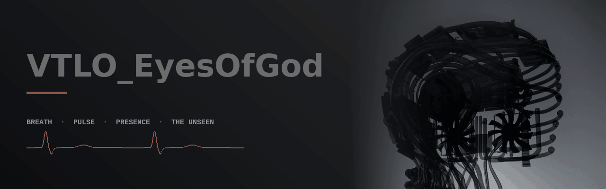
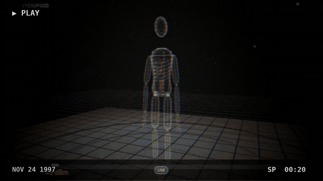

# VTLO_EyesOfGod

RADIOWAVES FROM MESH NETWORKS INCLUDING WIFI AND BLUETOOTH SIGNALS FROM CLOSEST ROUTERS AND DEVICES ARE USED TO BUILD THIS 'THROUGH WALLS PRESENCE MONITORING TOOL - PLEASE USE THIS CAREFULLY AS IT BYPASS MOST OF SIGNATURES PROTOCOLS TO LISTEN BROADCAST FROM DEVICES THAT YOU DONT OWN !

<p align="center"></p>

# VTLO_EyesOfGod

*The walls are not walls. They are a lens.*

Radio light passes through a room and returns carrying the shape of everything inside it: a breath, a pulse,
a body standing very still. EyesOfGod reads that light and shows what it finds.

One app, everywhere — **Android** and any **browser**, from a single codebase.

## The Chambers

| Chamber | What it shows | Open |
|---|---|---|
| **Live** | A translucent figure assembled from signal alone — organs, bone, a pulse that is almost human. | [Enter](https://vtlo.github.io/VTLO_Eyes0fGod/?chamber=live) |
| **Observatory** | Breath, heartbeat and presence rendered as concentric fields around the monitored space. | [Enter](https://vtlo.github.io/VTLO_Eyes0fGod/chambers/observatory.html) |
| **Vault** | The room remembered as a cloud of points; a skeleton rising out of it. | [Enter](https://vtlo.github.io/VTLO_Eyes0fGod/chambers/vault.html) |
| **Convergence** | Light and radio agree on a single body: camera pose and WiFi CSI fused into one estimate. | [Enter](https://vtlo.github.io/VTLO_Eyes0fGod/chambers/convergence.html) |
| **Vitals · Zones · MAT** | Heart and breath rates, occupancy heat, and survivor search. | [Enter](https://vtlo.github.io/VTLO_Eyes0fGod/) |

The app carries its own oracle: it runs fully on its own. When you own an ESP32-S3 node, bind it in
**Settings** (or press *Bind a Sensor…* in the Vault) and the chambers listen to your room instead —
the node itself keeps watching for presence, vital signs and falls even when nothing else is connected.

## Get it

The whole app runs in the browser at https://vtlo.github.io/VTLO_Eyes0fGod/ — or prebuilt files live in [`releases/`](releases/) (checksums in `SHA256SUMS`):

- `VTLO_EyesOfGod-android-arm64.apk` — sideload on Android 8+
- `VTLO_EyesOfGod-web.zip` — unzip and serve the folder from any static host

## Build it

```bash
cd chambers && npm install && npm run build      # bundles the three chambers into single offline files
cd ../app && npm install
npm run build:web                                  # -> app/dist/web
npx expo prebuild --platform android && cd android && ./gradlew assembleRelease
```

## Layout

- `app/` — the universal Expo / React Native app (Android + web)
- `chambers/` — Observatory, Vault and Convergence sources and the single-file bundler
- `releases/` — shipped builds

## Licence

MIT. See `LICENSE` and `NOTICE`.


-- UNAUTHORIZED USAGE REPORT -- source unknown
<p align="center">
  <a href="media/VTLO_EyesOfGod_film.mp4"></a><br>
  <sub><a href="media/VTLO_EyesOfGod_film.mp4">&#9654; Watch INCIDENT 7-ECHO (3:00)</a> &middot; <a href="media/SCENARIO.md">scenario</a></sub>
</p>